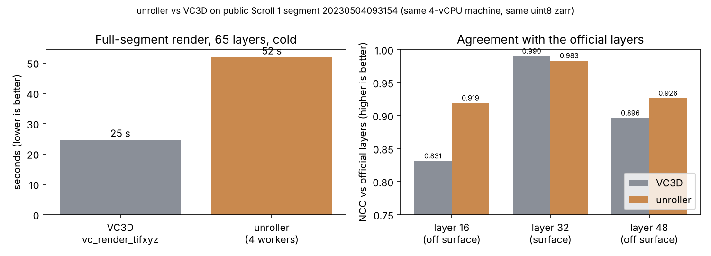
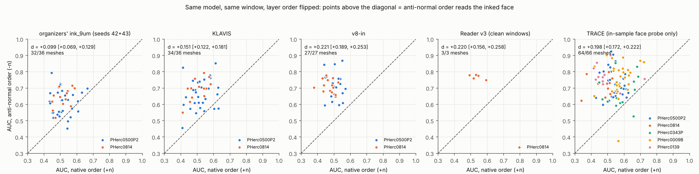
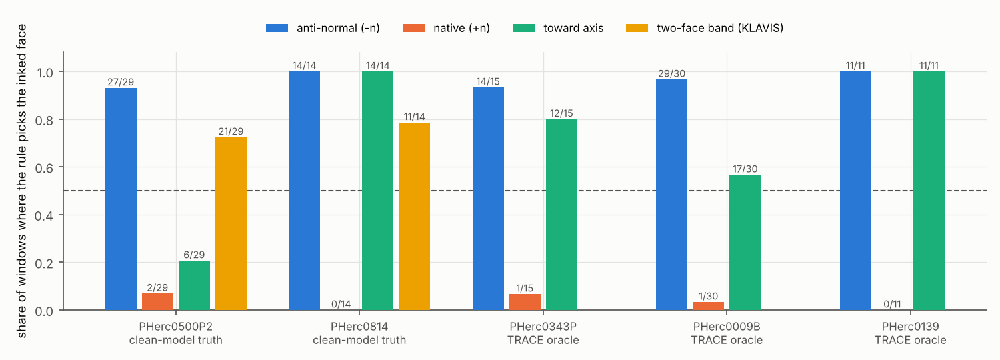
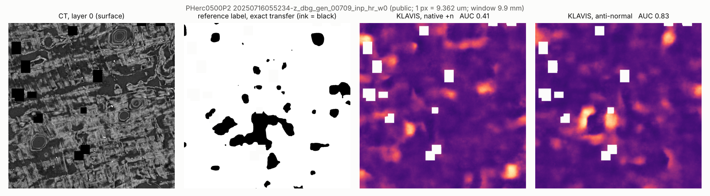
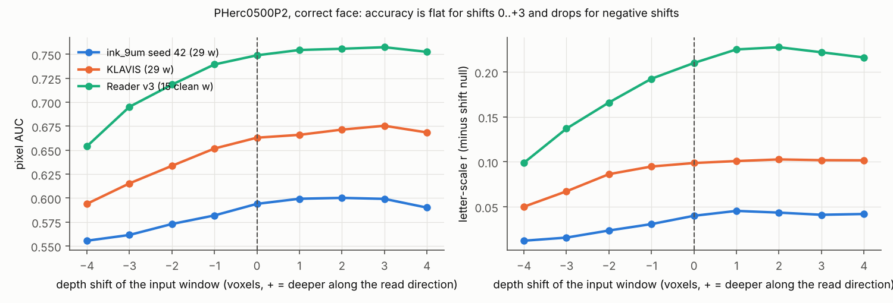
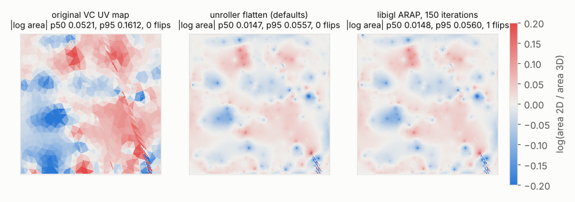
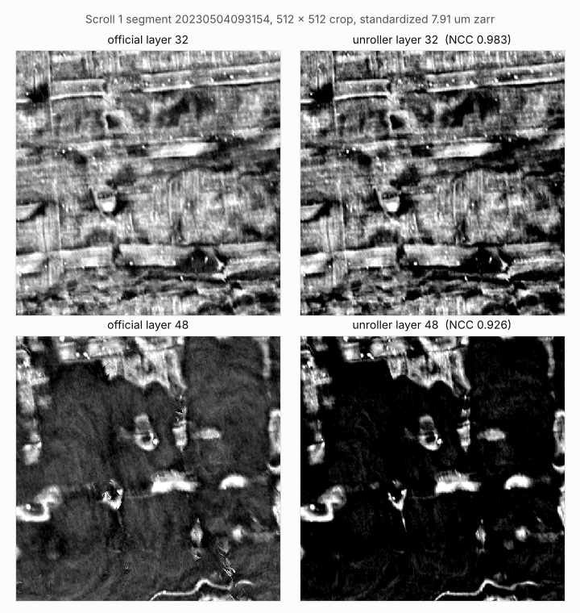
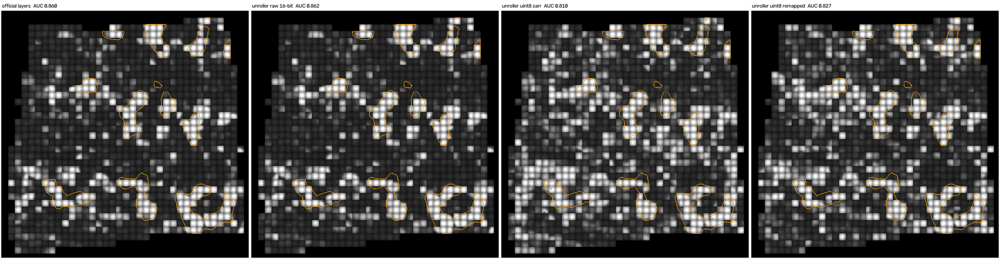
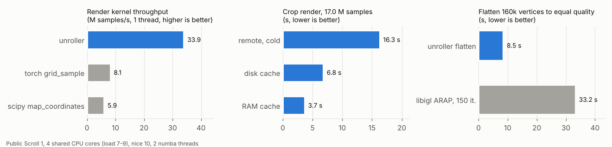

# VC4D

VC4D holds two open, CPU-only Python packages for the Vesuvius Challenge. Every number below was measured on
public data, and the scripts, raw results and figures that produced it are in this repository.

## Why use it

**[ink9face](ink9face/): read the right side of the sheet.** A 9 µm ink model sees a stack of layers around the
traced surface. If the stack is fed in the wrong order, the model reads the back of the sheet and its output is no
better than chance. villa's ink inference uses the "forward" order by default; on our public test windows that order
was the wrong one on 97 of 99 windows. ink9face gives a fixed rule that picks the inked face, a check for new meshes,
and a ready patch for villa. **Effect: +0.10 to +0.26 AUC on held-out data for 6 public 9 µm ink models** (for
example Reader v2: 0.51 -> 0.77). It also transfers the organizers' 2.2-2.4 µm ink labels onto 9 µm meshes exactly,
from geometry alone, for training and evaluation.

**[unroller](unroller/): the whole unwrapping pipeline in plain Python.** It traces, flattens, renders and solves
windings in the VC3D formats (`tifxyz`, `meta.json`, OME-Zarr, VC OBJ), installs with one `pip install` and runs on a
laptop CPU, streaming only the volume chunks it needs. What it does well, measured:
* **Flattening (2D unwrapping of the 3D mesh):** about **3x less area distortion** than the 2023 UV map of the same
  segment, **0 flipped triangles**, and **4-5x faster** than libigl ARAP at equal quality.
* **Renders that ink models read as well as the official ones:** the 2023 Grand Prize ink model scores unroller's
  renders at **AUC 0.862 vs 0.860** for the official layers.
* **Layers away from the surface stay faithful:** agreement with the official layers 16 and 48 is NCC 0.92-0.93.
* **No build step:** VC3D's C++ tools need a full compile with many system libraries; unroller is pure Python.

Flattening and rendering are different steps. Flattening decides where each point of the curved sheet lands in the
flat image (less distortion means letters keep their true shape). Rendering samples the CT volume at those points.
For raw rendering speed the C++ VC3D renderer is faster, and we show that comparison openly below; unroller's value
is the complete, easy-to-run pipeline and its flattening and ink-ready output.

## Measured results

| what | result | baseline and conditions |
|---|---|---|
| Trilinear render kernel (unroller) | **33.9 M samples/s**: **4.2x** torch `grid_sample`, **5.7x** scipy `map_coordinates` | 17.0 M samples at identical positions, 1 thread, shared 4-vCPU Xeon, no GPU; max difference 0.0075 grey levels (torch), 6.1e-5 (scipy) |
| Full segment render (unroller) | **74 s** for 65 layers, fetching 332.6 MB = **0.036 %** of the level-0 volume | Scroll 1 segment `20230504093154`, public remote OME-Zarr, cold cache, 2 workers, peak RSS 1.4 GB |
| ARAP flatten (unroller) | **8.5 s** for 160 k vertices, **0 flips**, \|log area\| p50 / p95 0.0147 / 0.0557 | libigl ARAP (150 iterations) on the same mesh: 33.2 s, 0.0148 / 0.0560, 1 flip, so **3.9x** faster at equal quality (**5.0x** in an earlier run on the same machine under heavier load) |
| Area distortion (unroller) | \|log area\| p50 / p95 0.0147 / 0.0557 | the 2023 VC UV map of the same crop: 0.052 / 0.161, so **about 3x lower** (3.5x / 2.9x) |
| Ink end use (unroller) | 2023 Grand Prize TimeSformer on unroller renders from the raw 16-bit volume: **AUC 0.862** | official layers: AUC 0.860; Δ **+0.003 [-0.002, +0.009]** (95 % CI, paired block bootstrap). Scroll 1 segment `20230531121653`, public GP labels (in the GP training set, so only the paired difference is meaningful). From the uint8 standardized zarr: 0.810 (Δ -0.049), caused by intensity clipping |
| Face / layer order (ink9face) | Reading the correct face raises held-out AUC by **+0.10 to +0.26** across **6 public 9 µm models** | renderer-default (native) order on the same windows. Per-model mesh-bootstrap 95 % CIs, for example ink_9um +0.099 [+0.069, +0.129] and Reader v2 +0.260 [+0.189, +0.324]. Each model is excluded on the segments it was trained on |
| Face rule (ink9face) | The fixed `anti_normal` rule picks the inked face on **97/99** windows | TRACE oracle on 5 public scrolls. Against clean-model truth: 41/43 windows. The native order picks it on 2/99 and the toward-axis rule on 62/99 |

### How it compares with VC3D

Same 4-vCPU machine, same public Scroll 1 segment and uint8 zarr, 65 layers, cold streaming
([raw numbers](unroller/benchmarks/results/vc3d_h2h/render_full_segment.json)):

| | VC3D `vc_render_tifxyz` (C++) | unroller (Python) |
|---|---|---|
| full-segment render time | **23-26 s** | 52 s (4 workers) |
| peak memory | 1.5 GB | 1.6 GB |
| agreement with official layer 32 (surface), NCC | **0.990** | 0.983 |
| agreement with official layers 16 / 48 (off surface), NCC | 0.831 / 0.896 | **0.919 / 0.926** |
| install | C++ build (cmake, Qt, OpenCV, Ceres, ...) | **`pip install`** |
| ARAP flattening, winding solver, ink-face rule in the same package | no | **yes** |



The conditions, caveats and negative results are in each package README:
[unroller/README.md](unroller/README.md) and [ink9face/README.md](ink9face/README.md).

## Figures

All figures are made from public data by the scripts in this repository.

| | |
|---|---|
|  |  |
| ink9face: AUC per window, wrong face vs correct face | ink9face: how often each rule picks the inked face |
|  |  |
| ink9face: one public window read from both faces | ink9face: accuracy vs depth offset |
|  |  |
| unroller: flattening distortion vs the 2023 UV map and libigl | unroller: rendered layers vs the official layers |
|  |  |
| unroller: Grand Prize ink model on unroller vs official renders | unroller: render kernel timing |

## Quick start

### unroller

```bash
pip install "git+https://github.com/abundantjoe/vc4d#subdirectory=unroller"
unroller validate          # synthetic phantom with exact ground truth; exit code 0 = pass (about 20 s)

ROOT=https://dl.ash2txt.org/full-scrolls/Scroll1/PHercParis4.volpkg
VOL=$ROOT/volumes_zarr_standardized/54keV_7.91um_Scroll1A.zarr
curl -sSfo seg.obj $ROOT/paths/20230504093154/20230504093154.obj
unroller obj2tifxyz seg.obj seg
unroller flatten    seg flat --downsample 4
unroller render     seg $VOL layers -n 65 --crop 384 2024 512 512 --workers 2 --disk-cache cache
# for ink detection, render from the raw 16-bit volume instead of the uint8 zarr:
unroller render     seg - layers16 -n 65 --volume-16bit $ROOT/volumes/20230205180739 --disk-cache cache
```

### ink9face

```bash
pip install "git+https://github.com/abundantjoe/vc4d#subdirectory=ink9face"
# layer order to feed a 9 um ink model for a tifxyz mesh (VC3D normal convention)
ink9face face  --mesh MESH9.tifxyz --crop 152 10 53 53
# exact labels for a window of a public segment, then score any ink map against them
ink9face labels --scroll PHerc0500P2 --segment 20250611132918-z_dbg_gen_00302_inp_hr --crop 152 10 53 53 --out out/w0
ink9face score --map p.tif --label out/w0_ink.tif --mask out/w0_mask.tif
```

In Python: `from ink9face.face import orient; stack = orient(native_stack)`.

## Repository layout

```
unroller/    tracing, ARAP flattening and rendering (package, tests, benchmarks, figures)
ink9face/    face / layer order, exact label transfer, metrics (package, eval, results, figures, villa_pr/ draft patch)
assets/      banner
.github/     CI: both test suites on Python 3.10 and 3.12
```

## Data

Every figure and test fixture here comes from public Vesuvius Challenge data (CC BY-NC 4.0): Scroll 1
(PHerc. Paris 4, EduceLab-Scrolls) for unroller, and the organizers' public meshes and ink outputs of PHerc0500P2,
PHerc0814, PHerc0343P, PHerc0009B and PHerc0139 for ink9face. No CT-derived material from First-Letters-eligible
scrolls is included, and no model weights. Data citations, model credits and licences are in
[CITATIONS.md](CITATIONS.md).

## Citation

```bibtex
@software{vc4d_2026,
  author = {abundantjoe},
  title  = {{VC4D}: unroller and ink9face, open tools for unwrapping and reading the Herculaneum scrolls},
  year   = {2026},
  url    = {https://github.com/abundantjoe/vc4d}
}
```

unroller also has its own [CITATION.cff](unroller/CITATION.cff).

## Licence

The code is under the MIT licence ([LICENSE](LICENSE)); each package carries a copy. The scroll data and anything derived
from it remain under the Vesuvius Challenge open-data terms (CC BY-NC 4.0); see [CITATIONS.md](CITATIONS.md).
