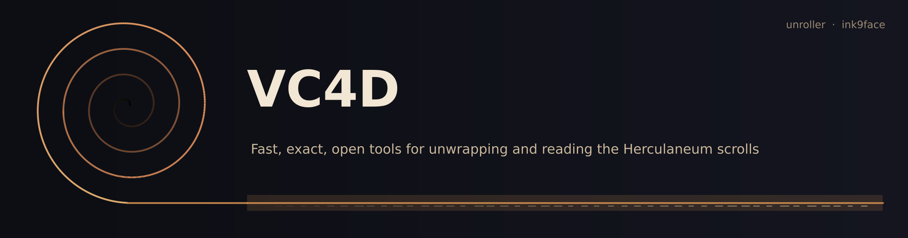

# VC4D

VC4D holds two small, open, CPU-only Python packages for the Vesuvius Challenge. **[unroller](unroller/)** traces,
flattens and renders scroll surfaces straight from the public OME-Zarr and TIFF volumes, in the VC3D formats
(`tifxyz`, `meta.json`, VC OBJ), so its output loads in VC3D and in the community ink models.
**[ink9face](ink9face/)** settles which face of a sheet an 8-9 µm ink model reads (the layer order). It also maps
organizer ink labels onto the 9 µm meshes exactly, from geometry alone. Every number below was measured on public
data, and the scripts and raw results that produced it ship next to the code.

## Measured results

| what | result | baseline and conditions |
|---|---|---|
| Trilinear render kernel (unroller) | **33.9 M samples/s**: **4.2x** torch `grid_sample`, **5.7x** scipy `map_coordinates` | 17.0 M samples at identical positions, 1 thread, shared 4-vCPU Xeon, no GPU; max difference 0.0075 grey levels (torch), 6.1e-5 (scipy) |
| Full segment render (unroller) | **74 s** for 65 layers, fetching 332.6 MB = **0.036 %** of the level-0 volume | Scroll 1 segment `20230504093154`, public remote OME-Zarr, cold cache, 2 workers, peak RSS 1.4 GB |
| ARAP flatten (unroller) | **8.5 s** for 160 k vertices, **0 flips**, \|log area\| p50 / p95 0.0147 / 0.0557 | libigl ARAP (150 iterations) on the same mesh: 33.2 s, 0.0148 / 0.0560, 1 flip, so **3.9x** faster at equal quality (**5.0x** in an earlier run on the same machine under heavier load) |
| Area distortion (unroller) | \|log area\| p50 / p95 0.0147 / 0.0557 | the 2023 VC UV map of the same crop: 0.052 / 0.161, so **about 3x lower** (3.5x / 2.9x) |
| Ink end use (unroller) | 2023 Grand Prize TimeSformer on unroller renders from the raw 16-bit volume: **AUC 0.862** | official layers: AUC 0.860; Δ **+0.003 [-0.002, +0.009]** (95 % CI, paired block bootstrap). Scroll 1 segment `20230531121653`, public GP labels (in the GP training set, so only the paired difference is meaningful). From the uint8 standardized zarr: 0.810 (Δ -0.049), caused by intensity clipping |
| Face / layer order (ink9face) | Reading the correct face raises held-out AUC by **+0.10 to +0.26** across **6 public 9 µm models** | renderer-default (native) order on the same windows. Per-model mesh-bootstrap 95 % CIs, for example ink_9um +0.099 [+0.069, +0.129] and Reader v2 +0.260 [+0.189, +0.324]. Each model is excluded on the segments it was trained on |
| Face rule (ink9face) | The fixed `anti_normal` rule picks the inked face on **97/99** windows | TRACE oracle on 5 public scrolls. Against clean-model truth: 41/43 windows. The native order picks it on 2/99 and the toward-axis rule on 62/99 |

**VC3D comparison** (same machine, same public Scroll 1 segment and uint8 zarr, 65 layers, cold streaming;
[`render_full_segment.json`](unroller/benchmarks/results/vc3d_h2h/render_full_segment.json)): the C++
`vc_render_tifxyz` (villa @ 2144fdd) renders the full segment in 23-26 s, unroller in 52 s with 4 workers, so
**VC3D is about 2.2x faster at rendering**. Peak memory is about the same (1.5 GB vs 1.6 GB). Agreement with the
official layers: VC3D is closer at the surface (NCC 0.990 vs 0.983), unroller is closer off the surface
(L16/L48: 0.919/0.926 vs 0.831/0.896). unroller's case is not raw render speed but a pure-Python, `pip install`
toolkit that also traces, flattens (ARAP), solves windings and feeds the ink models correctly.

The conditions, caveats and negative results are in each package README:
[unroller/README.md](unroller/README.md) and [ink9face/README.md](ink9face/README.md).

## Quick start

### unroller

```bash
pip install "git+https://github.com/abundantjoe/vc4d#subdirectory=unroller"
unroller validate          # synthetic phantom with exact ground truth; exit code 0 = pass (about 20 s)

ROOT=https://dl.ash2txt.org/full-scrolls/Scroll1/PHercParis4.volpkg
VOL=$ROOT/volumes_zarr_standardized/54keV_7.91um_Scroll1A.zarr
curl -sSfo seg.obj $ROOT/paths/20230504093154/20230504093154.obj
unroller obj2tifxyz seg.obj seg
unroller flatten    seg flat --downsample 4
unroller render     seg $VOL layers -n 65 --crop 384 2024 512 512 --workers 2 --disk-cache cache
# for ink detection, render from the raw 16-bit volume instead of the uint8 zarr:
unroller render     seg - layers16 -n 65 --volume-16bit $ROOT/volumes/20230205180739 --disk-cache cache
```

### ink9face

```bash
pip install "git+https://github.com/abundantjoe/vc4d#subdirectory=ink9face"
# layer order to feed a 9 um ink model for a tifxyz mesh (VC3D normal convention)
ink9face face  --mesh MESH9.tifxyz --crop 152 10 53 53
# exact labels for a window of a public segment, then score any ink map against them
ink9face labels --scroll PHerc0500P2 --segment 20250611132918-z_dbg_gen_00302_inp_hr --crop 152 10 53 53 --out out/w0
ink9face score --map p.tif --label out/w0_ink.tif --mask out/w0_mask.tif
```

In Python: `from ink9face.face import orient; stack = orient(native_stack)`.

## Repository layout

```
unroller/    tracing, ARAP flattening and rendering (package, tests, benchmarks, figures)
ink9face/    face / layer order, exact label transfer, metrics (package, eval, results, figures, villa_pr/ draft patch)
assets/      banner
.github/     CI: both test suites on Python 3.10 and 3.12
```

## Data

Every figure and test fixture here comes from public Vesuvius Challenge data (CC BY-NC 4.0): Scroll 1
(PHerc. Paris 4, EduceLab-Scrolls) for unroller, and the organizers' public meshes and ink outputs of PHerc0500P2,
PHerc0814, PHerc0343P, PHerc0009B and PHerc0139 for ink9face. No CT-derived material from First-Letters-eligible
scrolls is included, and no model weights. Data citations, model credits and licences are in
[CITATIONS.md](CITATIONS.md).

## Citation

```bibtex
@software{vc4d_2026,
  author = {abundantjoe},
  title  = {{VC4D}: unroller and ink9face, open tools for unwrapping and reading the Herculaneum scrolls},
  year   = {2026},
  url    = {https://github.com/abundantjoe/vc4d}
}
```

unroller also has its own [CITATION.cff](unroller/CITATION.cff).

## Licence

The code is under the MIT licence ([LICENSE](LICENSE)); each package carries a copy. The scroll data and anything derived
from it remain under the Vesuvius Challenge open-data terms (CC BY-NC 4.0); see [CITATIONS.md](CITATIONS.md).
