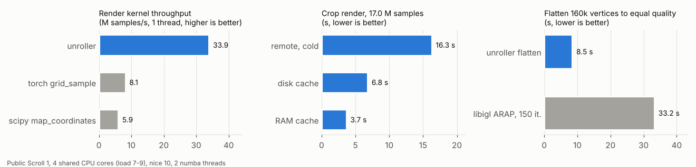
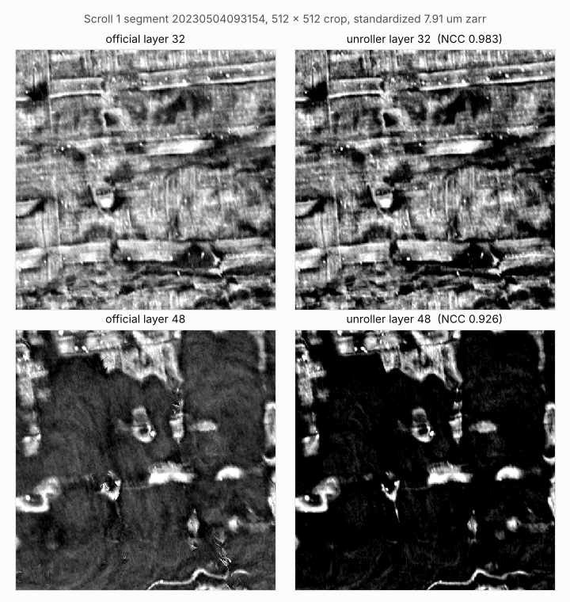
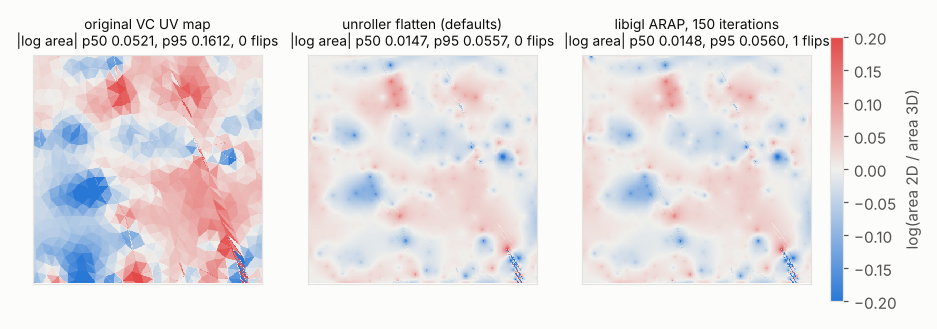
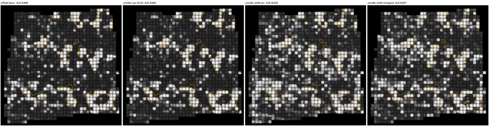
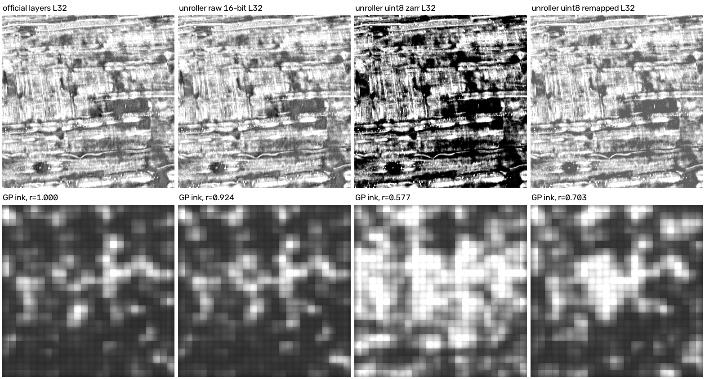
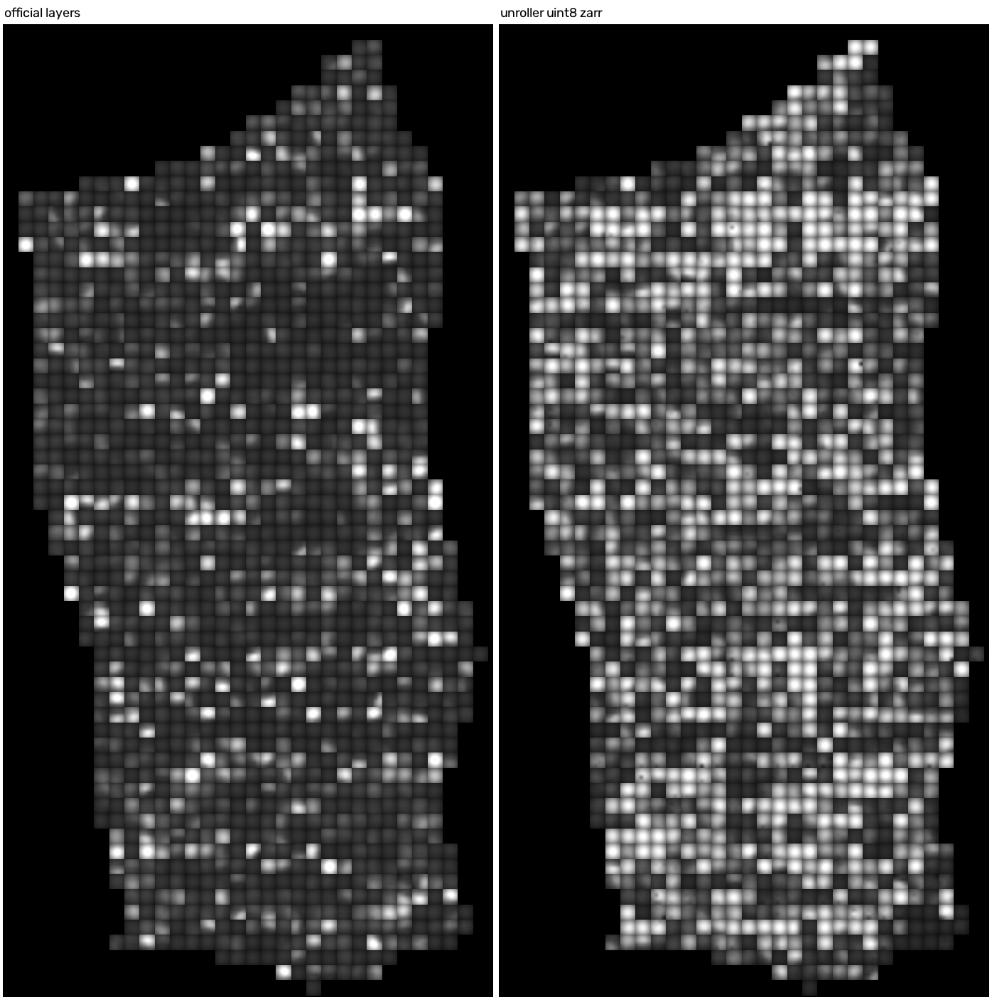

# unroller

[](https://github.com/abundantjoe/vc4d/actions/workflows/ci.yml)

Fast, pure-Python virtual unwrapping for Herculaneum scroll CT. It traces a sheet from a seed, flattens it with
ARAP and renders layer stacks along the normals, straight from the public OME-Zarr volumes. It reads and writes
the VC3D / volume-cartographer formats (`tifxyz`, `meta.json`, OME-Zarr, VC OBJ), so its output loads in VC3D and
the community ink-detection models.

- **Light install:** `pip install` brings in numpy, scipy, numba, tifffile, numcodecs, requests and pillow only.
  There is no Qt, Ceres, OpenCV, Boost, CUDA or Docker, and no GPU is needed.
- **Streams the public data:** OME-Zarr chunks are fetched over HTTPS on demand, in parallel, into a RAM LRU and an
  optional disk cache. A full Scroll 1 segment render fetches 0.036 % of the level-0 volume.
- **Compiled kernels:** the sampling, snapping and normal kernels are numba-compiled. The output is bit-identical
  to the reference numpy implementation, and `scripts/perf.py` checks that.
- **Built-in validation:** `unroller validate` builds a synthetic scroll with exact ground truth and fails when
  geometry or ink recovery goes over its thresholds.

## Headline numbers (measured, public data)

All rows come from `benchmarks/` on public Scroll 1 (PHerc. Paris 4) segment `20230504093154` and the standardized
7.91 µm OME-Zarr, except the two ink rows (segment `20230531121653`, the only one with public labels; 95 % CIs from a
paired block bootstrap). **Conditions:** Intel Xeon @ 2.10 GHz, 4 vCPUs shared with other jobs (load average 7-9),
15 GB RAM, no GPU, `nice -n 10`, `NUMBA_NUM_THREADS=2`, Python 3.13, numpy 2.5, numba 0.68, torch 2.15 (CPU),
libigl 2.6.3. Raw outputs are in `benchmarks/results/`.

| task | unroller | baseline on the same input | ratio |
|---|---|---|---|
| Trilinear sampling, 17.0 M samples, 1 thread | **33.9 M samples/s** | torch `grid_sample` 8.1 M/s; scipy `map_coordinates` 5.9 M/s | **4.2x**; **5.7x** |
| Agreement of the sampling (max abs. difference, grey levels) | - | torch 0.0075; scipy 6.1e-5 | - |
| Full segment render, 65 layers, cold cache, 2 workers | **74.2 s**, 332.6 MB fetched (0.036 % of level 0), peak RSS 1.4 GB | - | - |
| Flatten 160 k vertices, \|log area\| p50 / p95, flips | **8.5 s**, 0.0147 / 0.0557, 0 flips | libigl ARAP 150 it.: 33.2 s, 0.0148 / 0.0560, 1 flip | **3.9x** less time at equal quality |
| Area distortion against the original VC UV map (same crop) | \|log area\| p50 / p95 0.0147 / 0.0557 | VC UV map 0.052 / 0.161 | **3.5x / 2.9x** lower |
| Rendered layers against the official layers (NCC, same crop) | L32 0.983, L16 0.919, L48 0.926 | - | - |
| **Ink end use:** 2023 Grand Prize TimeSformer, AUC against the public GP labels (segment `20230531121653`) | 16-bit render (`--volume-16bit`): **0.862** | official layers: 0.860 | **+0.003 [-0.002, +0.009]**: no loss |
| Same, on the README-default uint8 standardized zarr | 0.810 | official layers: 0.860 | **-0.049 [-0.065, -0.035]**: a clear loss |

- An earlier run on the same machine at load 12-17 gave 23.0 M samples/s (3.1x / 5.6x), a 117-121 s full render and
  8.6 s against 43.1 s for libigl (5.0x). Its raw files are in `benchmarks/results/earlier_run_load12-17/`. All
  quality numbers (NCC, distortion, coverage, differences) were identical to every digit in both runs.
- **For ink detection, render from the raw 16-bit volume** (`--volume-16bit .../volumes/20230205180739`). The
  uint8 standardized zarr clips 10-13 % of the papyrus pixels to 0, which costs about 0.05 AUC with the GP model and
  inflates false ink (see [Ink end use](#ink-end-use-grand-prize-model-on-unroller-renders)).
- **VC3D renders about 2.2x faster than unroller** on the same machine and data; see [What is not claimed yet](#what-is-not-claimed-yet).



## Install

```bash
pip install "git+https://github.com/abundantjoe/vc4d#subdirectory=unroller"   # or: git clone ... && pip install -e unroller
pip install "git+https://github.com/abundantjoe/vc4d#subdirectory=unroller"   # same package, from the VC4D release
unroller validate                                                 # phantom benchmark, exit code 0 = pass (about 20 s)
```

Python 3.10 or newer. Optional extras: `.[bk]` (PyMaxflow for the winding solver), `.[test]`, `.[bench]` (torch,
libigl and matplotlib for the benchmarks).

## Quick start on public data (about 2.5 minutes on CPU)

Scroll 1 (PHerc. Paris 4), segment `20230504093154`. The same steps are in `scripts/quickstart_scroll1.sh`
(`bash scripts/quickstart_scroll1.sh WORKDIR`).

```bash
ROOT=https://dl.ash2txt.org/full-scrolls/Scroll1/PHercParis4.volpkg
VOL=$ROOT/volumes_zarr_standardized/54keV_7.91um_Scroll1A.zarr
curl -sSfo seg.obj $ROOT/paths/20230504093154/20230504093154.obj      # 3.6 MB

unroller obj2tifxyz seg.obj seg                       # VC OBJ (with UVs) -> tifxyz grid (4064 x 2037)
unroller info       seg                               # grid health: spacing error, folds, area
unroller flatten    seg flat --downsample 4           # ARAP on every 4th vertex, UVs upsampled; flat/flatten_report.json
unroller render     seg $VOL layers -n 65 --crop 384 2024 512 512 --workers 2 --disk-cache cache
                                                      # 65 layers along the normals: layers/00.tif .. 64.tif
unroller trace      $VOL traced --seed 3415.6 3753.4 10108.3 --generations 40 --disk-cache cache
                                                      # grow a new sheet from one seed point
```

Measured on the machine above while the test suite ran next to it: **142 s wall in total** (conversion 8 s, info
6 s, flatten 112 s, crop render 12 s with a cold cache, trace 4 s). It downloads 3.6 MB of mesh and about 35 MB
of volume chunks and writes about 250 MB. The whole-segment flatten reports |log area| p50 / p95 0.020 / 0.094.
To render the whole segment, drop `--crop`: that takes about 75 s and fetches about 330 MB.

The layer stack is in the layout that the `vesuvius` ink-detection code and the Vesuvius `ink_9um` / Grand Prize
models expect. The quick start reads the uint8 standardized zarr, which is right for geometry but not for ink. For
ink detection render from the raw 16-bit TIFF volume instead (about 7.5 min and 2.9 GB of transfer for a whole
segment at 31 layers):

```bash
unroller render seg - layers16 -n 65 --volume-16bit $ROOT/volumes/20230205180739 --disk-cache cache
```

| VC3D | unroller | Notes |
|---|---|---|
| `QuadSurface` (`x/y/z.tif`, `meta.json`) | `unroller.Surface` | `-1` = invalid on disk, NaN in memory |
| `vc_render_tifxyz -n N --slice-step s` | `unroller render -n N --step s` | same symmetric offsets `(i-(N-1)/2)*s`, trilinear sampling, level scaling |
| `vc_flatten` (ABF++ -> LSCM) | `unroller flatten` | grid-initialised multiresolution ARAP (`--init lscm` also available) |
| `vc_obj2tifxyz` | `unroller obj2tifxyz` | recovers per-axis UV scale from 3D edge lengths |
| `vc_grow_seg_from_seed` | `unroller trace` | mean-shift snap along normals, plane-fit front, wrap-jump gates (see limits) |
| *(none)* | `unroller.ws.solve` | exact integer L1 winding-number assignment by max-flow (certified optimum) |
| *(none)* | `unroller validate`, `metrics` | phantom ground truth, distortion singular values, sheet-centring |

## Formats

- **Input meshes:** tifxyz folders (`x.tif`, `y.tif`, `z.tif`, `meta.json`, as written by VC3D) or VC OBJ with UVs
  (`obj2tifxyz`).
- **Volumes:** OME-Zarr v2 over HTTPS or on disk (any pyramid level, `--level`), in-memory numpy arrays, and
  HTTP TIFF stacks (`--volume-16bit`, for the raw 16-bit scans). Remote reads retry dropped transfers,
  connection resets and 429/5xx answers with exponential backoff (`UNROLLER_HTTP_RETRIES`, default 5).
- **Output:** tifxyz (traced, flattened and refined meshes), `NN.tif` layer stacks and `layers.zarr`, and JSON
  reports (`flatten_report.json`, `surface_report.json`, `stack_report.json`).

## Measured on public data: details

### Render: same samples, 4-6x faster than the Python primitives

512 × 512 crop, 65 layers, 17.0 M trilinear samples at identical positions (`bench_render.py`):

| implementation | time | throughput | max abs. difference to unroller |
|---|---|---|---|
| **unroller** fused kernel (1 thread) | **0.50 s** | **33.9 M samples/s** | - |
| `torch.nn.functional.grid_sample` (trilinear, 1 thread) | 2.10 s (+1.75 s to build the positions) | 8.1 M samples/s | 0.0075 grey levels, 0 samples > 0.5 |
| `scipy.ndimage.map_coordinates` (order 1) | 2.88 s | 5.9 M samples/s | 6.1e-5 |

- With 2 threads the unroller kernel was no faster (34.6 M samples/s): the shared machine was core-limited.
- The same crop rendered through the whole pipeline takes 16.3 s from the remote zarr with a cold cache
  (36.3 MB in 56 requests, including numba compilation), 6.8 s from the disk cache and 3.7 s from the RAM cache.
  The four paths give bit-identical results.
- The benchmark process peaked at 3.5 GB RSS, including the dense block and the torch and scipy baselines.
- **Full segment** (`render -n 65 --workers 2 --no-tif`, cold, no disk cache): 74.2 s wall time. It fetched
  332.6 MB in 450 requests and wrote a 262 MB uint8 zarr (valid fraction 0.72). Peak RSS was 1.4 GB.
- **Agreement with the official layers** (NCC on the same crop, best registration at shift 0,0):

  | layer | raw normals | smoothed normals (σ = 6, default) |
  |---|---|---|
  | 32 | 0.983 | 0.983 |
  | 16 | 0.871 | 0.919 |
  | 48 | 0.895 | 0.926 |



### Flatten: 3x less area distortion than the original VC UV map, 4-5x faster than libigl ARAP at equal quality

400 × 400 vertex crop (160 k vertices, 318 k triangles, `bench_flatten.py`):

| method | time | abs. log-area distortion p50 / p95 | anisotropy p95 | flipped triangles |
|---|---|---|---|---|
| original 2023 VC UV map | - | 0.052 / 0.161 | 1.080 | 0 |
| **unroller flatten** (defaults) | **8.5 s** | **0.0147 / 0.0557** | **1.053** | **0** |
| libigl 2.6.3 ARAP, 40 iterations | 10.7 s | 0.048 / 0.341 | 1.358 | 122 |
| libigl 2.6.3 ARAP, 150 iterations | 33.2 s | 0.0148 / 0.0560 | 1.054 | 1 |

- libigl times include its 3.2 s precomputation. libigl ran mostly single-threaded with an untuned schedule;
  unroller used 2 threads. The ratio was 3.9x in this run and 5.0x in the earlier run at higher load (8.6 s against
  43.1 s), hence "4-5x".
- Peak RSS of the benchmark process (including libigl) was 1.2 GB.
- An earlier whole-segment result (internal history) was |log area| p50 0.104 -> 0.020 against the VC UV map, and
  an area of 3.819 cm² against the published 3.857 cm² (-1.0 %).



### Ink end use: Grand Prize model on unroller renders

The 2023 Grand Prize TimeSformer (`scrollprize/timesformer_GP_scroll1`) was run with the GP repository's
preprocessing (layers 17-42, `>> 8`, clip 0-200) on four inputs: the official layers and three unroller renders of
the same official mesh. Scripts and the full protocol: `benchmarks/ink_gp/`; numbers: `benchmarks/results/ink_gp/`.
CPU only, bf16 autocast.

| input | AUC vs GP labels (`20230531121653`) | ΔAUC vs official [95 % CI] | ink-map r vs official (0531 / 0504 crop) |
|---|---|---|---|
| official layers | 0.860 | - | 1 / 1 |
| **unroller, raw 16-bit volume** (`--volume-16bit`) | **0.862** | **+0.003 [-0.002, +0.009]** | 0.970 / 0.924 |
| unroller, uint8 standardized zarr | 0.810 | -0.049 [-0.065, -0.035] | 0.749 / 0.577 |
| unroller, uint8 remapped to the official histogram | 0.827 | -0.032 [-0.043, -0.018] | 0.818 / 0.703 |

- **Win:** from the 16-bit volume, unroller's render is as good an ink-model input as the official layers. The
  difference is inside ±0.01 AUC, the input layers match the official ones to r 0.981-0.985, and their mean / std
  (140.8 / 43.3) match the official 140.3 / 43.3 on the same crop.
- **Loss:** from the uint8 standardized zarr (the quick-start default), AUC drops by 0.049 and false ink rises (mean
  ink probability over the whole of `20230504093154` 0.35 against 0.20; ink-map r 0.51). The geometry is the same
  (input r 0.97); the cause is intensity: the zarr maps 10-13 % of in-mask pixels to 0, outside the model's
  0-200 window. Remapping the histogram recovers only a third of the loss, because clipped values cannot be restored.
- **Caveats:** the GP labels of `20230531121653` were in the GP training set, so the absolute AUCs are in-sample;
  the paired difference between renders is what this measures. One labelled segment, 79 blocks of 256 px,
  200 bootstrap resamples. Segment `20230504093154` has no labels and no legible letters in the GP map, so it
  only gives correlations.
- Cost: the whole of `20230531121653` at 31 layers from the 16-bit volume took 471 s and 2.9 GB of range requests
  (25 k requests). Two of three attempts were lost to connection resets from the server relay before this
  release added retry with backoff to every remote store.





GP ink probability over the whole of `20230504093154` (no labels): official layers (left) against an unroller render
of the uint8 standardized zarr (right). The clipped zarr input raises false ink everywhere (mean 0.35 against 0.20);
render from the 16-bit volume instead.



### Trace

- 40 generations from two seeds on the official mesh, on the public remote zarr (`bench_trace.py`): 0.23-0.47 s
  per trace once warm. The first call takes 0.5-15 s (numba compilation plus 1.5-7.6 MB of chunk fetches; the
  15.4 s case was dominated by the network). Peak RSS was 0.5 GB.
- Share of traced vertices within 2 voxels of the official mesh: seed 0 0.253 (default) and 0.240 (LEGACY),
  seed 1 0.410 and 0.400. This measures overlap with one official mesh, not tracing accuracy.
- On 36 human-labelled Scroll 1 cubes × 3 seeds (internal study), the wrap-jump safeguards (default, C2) cut
  jump-like traces from 15 to 2 (sign test p = 0.001) and raised the share on the seed's own sheet from 90.7 % to
  96.5 %. The cost: 13 % of the traces that the previous tracer grew cleanly keep less than half of their
  coverage. `trace(..., **trace.LEGACY)` restores the previous tracer.

### Winding solver (`unroller.ws.solve`)

- Exact integer L1 winding assignment by steepest descent with max-flow moves. Every result carries an optimality
  certificate.
- On synthetic sheetlet graphs with 1e6 nodes and 1.06e7 edges (6.9 % wrong edges), a stitched start converges in
  141 s, against 3252 s cold, to the identical certified optimum. Accuracy is 0.99997.
- The PyMaxflow (BK) backend is 4.1x faster than scipy's max-flow. Gates and logs are in `results/ws_solve/`.
- This is measured on synthetic graphs only, not yet on real scroll data.

## What is **not** claimed yet

- **Rendering is slower than VC3D.** On the same machine and data (full Scroll 1 segment 20230504093154, 65 layers,
  uint8 zarr, cold streaming), the C++ `vc_render_tifxyz` (villa @ 2144fdd) takes 23-26 s and unroller 52 s with
  4 workers: VC3D is about 2.2x faster. Peak memory is similar (1.5 vs 1.6 GB). Against the official layers VC3D
  agrees more closely at the surface (NCC 0.990 vs 0.983) and unroller off the surface (L16/L48 0.919/0.926 vs
  0.831/0.896). Numbers: `benchmarks/results/vc3d_h2h/render_full_segment.json`. The tracer
  (`vc_grow_seg_from_seed`) has not been timed against unroller's yet.
- The flattener has not been compared with VC3D's production flattener `flatboi` (SLIM, symmetric Dirichlet
  energy). The flattening comparison is against the original 2023 UV map and libigl ARAP only.
- The tracer has not been compared with `vc_grow_seg_from_seed` for accuracy on labelled real data, and there is
  no cross-section figure yet that shows a traced sheet does not jump between wraps.
- All timings come from one shared 4-core machine; absolute times move with its load (see the two runs above).
- **Ink:** the Grand Prize model scores unroller renders as well as the official layers only when they come from the
  raw 16-bit volume. Renders of the uint8 standardized zarr lose about 0.05 AUC (see above). This was measured on
  one labelled Scroll 1 segment with labels the model was trained on, and with one ink model; the newer
  `ink_9um` / koine models have not been run on unroller renders.
- `crackle` is a weak ink-side texture hint, not an ink detector.

## Reproduce the benchmarks and figures

```bash
pip install -e ".[bench]"
ROOT=https://dl.ash2txt.org/full-scrolls/Scroll1/PHercParis4.volpkg
W=work; mkdir -p $W/official && curl -sSfo $W/seg.obj $ROOT/paths/20230504093154/20230504093154.obj
for L in 16 32 48; do curl -sSfo $W/official/$L.tif $ROOT/paths/20230504093154/layers/$L.tif; done
unroller obj2tifxyz $W/seg.obj $W/seg                            # grid for render and trace
unroller obj2tifxyz $W/seg.obj $W/seg_uv --uv-size 2068 4102     # grid on the official layer pixels
python benchmarks/scripts/bench_render.py  $W render.json  384 2024 512 512 65
python benchmarks/scripts/bench_flatten.py $W flatten.json 420 2080 400
python benchmarks/scripts/bench_trace.py   $W trace.json
python benchmarks/scripts/ncc_official.py  $W seg_uv ncc.json
unroller render $W/seg $ROOT/volumes_zarr_standardized/54keV_7.91um_Scroll1A.zarr $W/full -n 65 --workers 2 --no-tif
python benchmarks/scripts/make_figs.py     $W benchmarks/results docs/figs
python scripts/perf.py                                           # stage timings + bit-exact fingerprints (phantom)
bash   scripts/e2e_scroll1.sh $W e2e.json                        # whole CLI pipeline with profiles
```

## Tests

`pip install -e ".[test,bk]" && pytest`. On the machine above the suite takes 5-7.5 minutes (128 passed; the
PyMaxflow test is skipped when `.[bk]` is not installed). CI runs it on Python 3.10 and 3.12
(`.github/workflows/tests.yml`).

## Layout

```
unroller/            package: surface, volume (OME-Zarr / HTTPS / LRU), _kernels + snap_fast (numba),
                     trace, refine, regularize, flatten, resample, render, metrics, phantom / wholescroll, cli
unroller/ws/         exact L1 winding solver, confidence, whole-scroll flatten / render helpers
benchmarks/          public-data benchmark scripts, their raw results and the figure script;
                     benchmarks/ink_gp/: Grand Prize ink-model check on unroller renders
docs/figs/           README figures (public Scroll 1)
scripts/             quickstart_scroll1.sh, perf.py (timing + bit-exact checks), e2e_scroll1.sh, ws_bench_solve.py
tests/               unit, regression and perf-equivalence tests (tests/data: 64^3 Scroll 1 crop)
```

## Citation, licence and data

- Cite with `CITATION.cff` (GitHub shows a "Cite this repository" button). Changes are in `CHANGELOG.md`.
- Code: MIT (see `LICENSE`).
- `tests/data/scroll1_cube64.npz` is a 64³ crop of Scroll 1 (PHerc. Paris 4). The figures in `docs/figs/` and the
  benchmark results are derived from the same public scroll and its published segment. All of it is Vesuvius
  Challenge data from the EduceLab-Scrolls dataset under CC BY-NC 4.0; cite it as in [../CITATIONS.md](../CITATIONS.md).
- The ink figures use the 2023 Grand Prize TimeSformer weights (`scrollprize/timesformer_GP_scroll1`, MIT) and the
  GP hand labels of segment `20230531121653` from the Grand Prize winners' repository
  (`younader/Vesuvius-Grandprize-Winner`). Neither is redistributed here.
- This repository contains no data from any other scroll.
